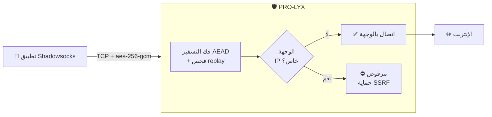
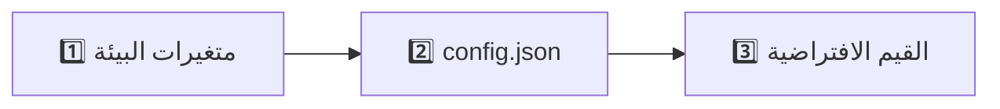

<div align="center">



<br/>


**سيرفر Shadowsocks خفيف مكتوب بـ Node.js الصافي — من غير أي dependencies**
بيكتشف البورت والـ IP العام لوحده، وبيطبعلك لينك `ss://` جاهز للاستيراد.

[✨ المميزات](#-المميزات) · [🚀 التشغيل](#-التشغيل-السريع) · [⚙️ الإعدادات](#️-الإعدادات) · [📱 التطبيق](#-الإعداد-اليدوي-في-التطبيق) · [🛡️ الأمان](#️-الأمان) · [📝 ملاحظات](#-ملاحظات)


</div>

<div dir="rtl">

## 🎯 ليه PRO-LYX؟

<table>
<tr>
<td width="25%" align="center"><h3>📦</h3><b>صفر مكتبات</b><br/><sub>موديولات Node.js الأساسية بس<br/>لا <code>npm install</code> ولا <code>node_modules</code></sub></td>
<td width="25%" align="center"><h3>🔍</h3><b>اكتشاف تلقائي</b><br/><sub>البورت والـ IP العام<br/>من البانل ومن أكتر من خدمة</sub></td>
<td width="25%" align="center"><h3>🔗</h3><b>لينك جاهز</b><br/><sub>بيطبع <code>ss://</code> وقت التشغيل<br/>انسخه واستورده</sub></td>
<td width="25%" align="center"><h3>🥷</h3><b>صعب الكشف</b><br/><sub>بيتجاهل الاتصالات الغلط بصمت<br/>بدل ما يقفلها</sub></td>
</tr>
</table>

<div align="center"></div>

## 🧭 إزاي بيشتغل؟



<div align="center"></div>

## ✨ المميزات

| | الميزة | التفاصيل |
|:--:|:--|:--|
| 📦 | **بدون مكتبات خارجية** | موديولات Node.js الأساسية بس |
| 🔐 | **تشفير AEAD** | `aes-256-gcm` (على TCP) |
| 🔌 | **اكتشاف البورت** | `SERVER_PORT` و `ALLOCATION_PORT` و `PORT` ... أوتوماتيك |
| 🌍 | **اكتشاف الـ IP العام** | من أكتر من خدمة |
| 🔗 | **لينك `ss://` جاهز** | بيتطبع وقت التشغيل |
| 🚫 | **حماية SSRF** | بيمنع الاتصال بالـ IPs الخاصة/المحلية افتراضيًا |
| 🔑 | **باسورد تلقائي** | لو مفيش باسورد بيولّد واحد ويحفظه لوحده |
| ♻️ | **حماية Replay** | + حد أقصى للاتصالات المتزامنة |
| 🥷 | **صامت عند الخطأ** | بيتجاهل الاتصالات الغلط بدل ما يقفلها (أصعب في الكشف) |

<div align="center"></div>

## 📋 المتطلبات

- 🟢 Node.js إصدار **16** أو أحدث
- 🔌 بورت من نوع **TCP** (مش HTTP بس)

## 🚀 التشغيل السريع

```bash
npm start
```

أو

```bash
node server.js
```

وقت التشغيل السيرفر هيطبع بيانات الاتصال ولينك `ss://` — استورده في أي تطبيق Shadowsocks 🎉

> [!TIP]
> أول ما يشتغل، انسخ لينك `ss://` من اللوجات وافتحه في التطبيق مباشرة — مش محتاج تكتب أي بيانات بإيدك.

<div align="center"></div>

## ⚙️ الإعدادات

كل الإعدادات **اختيارية**. الأولوية:



<details open>
<summary><b>📄 ملف <code>config.json</code></b></summary>
<br/>

```json
{
  "password": "your-strong-password",
  "host": "",
  "port": 8388
}
```

| الحقل | الوصف |
|:--|:--|
| `password` | الباسورد (8 حروف على الأقل). لو فاضي بيتولّد أوتوماتيك. |
| `host` | الهوست/IP العام اللي يظهر في اللينك. سيبه فاضي للاكتشاف التلقائي. |
| `port` | بورت التشغيل (بيتستخدم لو مفيش متغير بيئة من البانل). |

</details>

<details>
<summary><b>🌐 متغيرات البيئة</b></summary>
<br/>

| المتغير | الوصف |
|:--|:--|
| `SS_PORT` / `SERVER_PORT` / `ALLOCATION_PORT` / `PORT` | بورت التشغيل (قيم البانل ليها الأولوية) |
| `SS_BIND` | عنوان الـ bind (الافتراضي `0.0.0.0`) |
| `SS_HOST` | تحديد الهوست العام يدويًا |
| `SS_PASSWORD` | تحديد الباسورد يدويًا |
| `SS_MAX_CONN` | أقصى عدد اتصالات في نفس الوقت (الافتراضي `1024`) |
| `ALLOW_PRIVATE=1` | السماح بالاتصال بالـ IPs الخاصة (الافتراضي: مقفول) |

</details>

<div align="center"></div>

## 📱 الإعداد اليدوي في التطبيق

لو الـ IP العام ما اتكشفش، دخّل البيانات دي في تطبيق Shadowsocks:

| الحقل | القيمة |
|:--|:--|
| 🖥️ **السيرفر** | IP نود Katabump بتاعك |
| 🔌 **البورت** | البورت اللي اتطبع وقت التشغيل |
| 🔐 **الطريقة (Method)** | `aes-256-gcm` |
| 🔑 **الباسورد** | الباسورد بتاعك |

<div align="center"></div>

## 🛡️ الأمان

| | الحماية | التفاصيل |
|:--:|:--|:--|
| 🔐 | **تشفير AEAD** | `aes-256-gcm` |
| 🚫 | **SSRF** | منع الاتصال بالـ IPs الخاصة/المحلية افتراضيًا (`ALLOW_PRIVATE=1` لفتحه) |
| ♻️ | **Replay** | حماية من إعادة الإرسال |
| 📉 | **حد الاتصالات** | `SS_MAX_CONN` (الافتراضي 1024) |
| 🥷 | **الصمت عند الخطأ** | الاتصالات الغلط بتتجاهل بدل ما تتقفل |

> [!WARNING]
> متشاركش الباسورد أو ملف `config.json` أو لينك `ss://` مع حد — اللينك فيه الباسورد.

<div align="center"></div>

## 📝 ملاحظات

> [!IMPORTANT]
> 🔄 **جدّد سيرفر Katabump كل 4 أيام.**

- ✅ اتأكد إن الـ allocation من نوع **TCP**.
- 📱 ده **Shadowsocks** مش MTProto — استخدم تطبيق Shadowsocks.
- 🔒 متشاركش الباسورد أو ملف `config.json` مع حد.

<div align="center">


### 👑 الحقوق

صُنع بكل 💜 بواسطة

**Lynox** &nbsp;·&nbsp; **KHALED**

© Lynox & KHALED — جميع الحقوق محفوظة.

</div>

</div>
